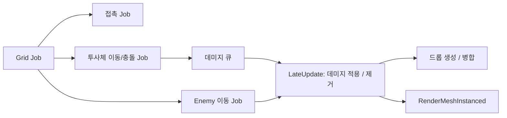

# portfolio-01

몰려드는 대량의 적을 자동 공격으로 처치하며 버티는 Unity 쿼터뷰 서바이버 프로토타입.

<!--  -->

- Unity 6000.6.7f1, URP, Input System
- 다운로드: [Releases](https://github.com/lolisia/portfolio-01/releases/latest) (Windows x64)

## 구현

**Enemy** ([EnemyManager.cs](Client/Assets/Scripts/aisilol/Game/EnemyManager.cs))
- Enemy는 GameObject 없이 `NativeList`에 위치/속도/체력만 저장
- 매 프레임 Burst Job으로 공간 해시 격자([SpatialGrid.cs](Client/Assets/Scripts/aisilol/Game/SpatialGrid.cs))를 만들고, 이동 / 겹침 밀어내기 / 플레이어 접촉 판정이 격자를 공유
- 이동은 위치 이중 버퍼. 이웃 위치를 읽는 동안 덮어쓰지 않음
- Update에서 Job 예약, LateUpdate에서 완료 후 데미지 적용 / 사망 제거(swap-back)를 Burst `IJob`으로 처리
- 렌더링은 `Graphics.RenderMeshInstanced`로 1023개씩 묶어서 처리 ([InstancedMesh.cs](Client/Assets/Scripts/aisilol/Game/InstancedMesh.cs))
- 카메라 시야 밖은 Burst Job으로 제외한 뒤 렌더링. Enemy / 투사체 / 드롭 공용 ([InstanceRenderer.cs](Client/Assets/Scripts/aisilol/Game/InstanceRenderer.cs))
- 스폰 위치는 카메라 화면 모서리를 지면에 투영해서 항상 화면 밖으로 계산. 초당 생성 수는 레벨에 따라 지수 증가(기본값 * 증가율^(레벨 - 1)), 체력은 경과 시간 커브로 증가
- Enemy 수는 고정 상한 없음. 평균 FPS(0.5초 지수 이동 평균)가 기준(기본 60) 아래면 생성 중지
- 한 프레임 생성 수는 상한(기본 100)까지. 넘는 수는 이월하지 않음

**투사체** ([ProjectileSystem.cs](Client/Assets/Scripts/aisilol/Game/ProjectileSystem.cs))
- 사거리 안의 가장 가까운 Enemy로 자동 발사. 투사체도 GameObject 없이 데이터로 처리
- 이동 + 충돌은 Burst `IJobParallelFor`. 한 프레임 이동 구간(선분)으로 판정해서 빠른 투사체도 Enemy를 건너뛰지 않음
- 관통 수만큼 구간 위의 Enemy를 가까운 순서로 맞힘. 밀집할수록 한 발에 여러 마리 처치
- 맞힌 Enemy는 `NativeQueue` 데미지 큐에 기록하고, EnemyManager가 LateUpdate에서 일괄 적용

**드롭** ([PickupSystem.cs](Client/Assets/Scripts/aisilol/Game/PickupSystem.cs))
- Enemy 사망 위치에 경험치 Object, 확률로 HP 포션 드롭. 경험치는 Object를 획득해야 증가
- 포션 드롭 확률은 플레이어 HP 비율 커브. HP가 낮을수록 높음
- 자석 범위 안에 들어오면 플레이어에게 끌려와 획득. 이동 / 획득 판정은 Burst Job
- 레벨업하면 맵에 남은 경험치 Object를 모두 끌어옴
- 가까이 모인 같은 단계의 경험치 Object 10개를 다음 단계 1개로 병합(1 → 10 → 100 ...). 셀 + 단계로 정렬 후 묶음 처리
- 병합 범위는 0단계 0.5m, 단계마다 3배. 단계별로 색과 크기가 다름
- 드롭 생성 / 획득 / 제거는 Burst `IJob`

**성장** ([PlayerStats.cs](Client/Assets/Scripts/aisilol/Game/PlayerStats.cs), [UpgradeDefinition.cs](Client/Assets/Scripts/aisilol/Game/UpgradeDefinition.cs))
- 레벨업 시 일시 정지 후 강화 3택 1
- 강화는 ScriptableObject 에셋([Data/Upgrades](Client/Assets/Data/Upgrades)). 능력치 / 적용 방식(Add, Percent) / 값 / 최대 레벨만 입력
- 능력치 = (기본값 + Add 합) * (1 + Percent 합)

**게임 진행** ([GameManager.cs](Client/Assets/Scripts/aisilol/Game/GameManager.cs), [GameHud.cs](Client/Assets/Scripts/aisilol/Game/GameHud.cs))
- Playing / LevelUp / GameOver 상태. 접촉 피해는 무적 시간 0.5초 단위
- HUD(체력/경험치 바, 선택지, 결과 화면)는 uGUI를 코드로 구성

**Floor** ([FloorManager.cs](Client/Assets/Scripts/aisilol/Game/FloorManager.cs))
- 카메라 Frustum에 걸리는 타일만 배치, 벗어난 타일은 Pool로 재사용

**공용** ([Utility.cs](Client/Assets/Scripts/aisilol/Common/Utility.cs), [Log.cs](Client/Assets/Scripts/aisilol/Common/Log.cs))
- `TryInstantiate` / `TryGetComponent` 실패 시 Caller 정보(파일:라인)를 포함해 로그 출력

## 테스트 / CI

- PlayMode 테스트 154개: [Client/Assets/Tests](Client/Assets/Tests). Job은 단위 테스트, 시스템은 빈 씬에서 통합 테스트
- push / PR 시 테스트 + 커버리지 + SonarQube Cloud 분석 ([sonarqube.yml](.github/workflows/sonarqube.yml))
- `v*` 태그 push 시 GameCI로 Windows 빌드 후 Release 업로드 ([release.yml](.github/workflows/release.yml))

## 실행

`Client` 폴더를 Unity 6000.6.7f1로 열고 `Assets/Scenes/GameScene.unity` 실행. 공격은 자동.

| 입력 | 키 |
| --- | --- |
| 이동 | WASD / 방향키 / 왼쪽 스틱 |
| 줌 | 마우스 휠 |
| 강화 선택 | 1 / 2 / 3, 마우스 클릭 |
