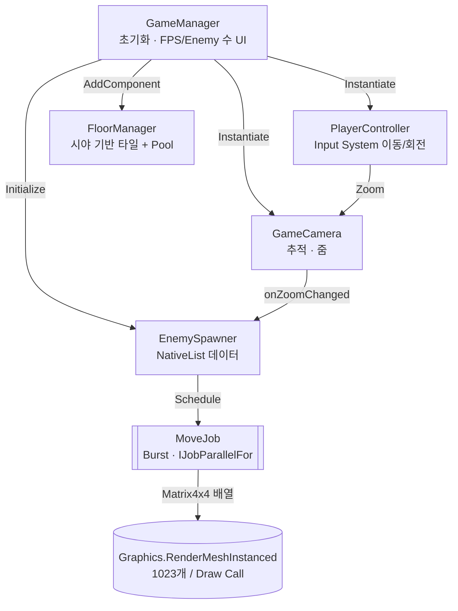
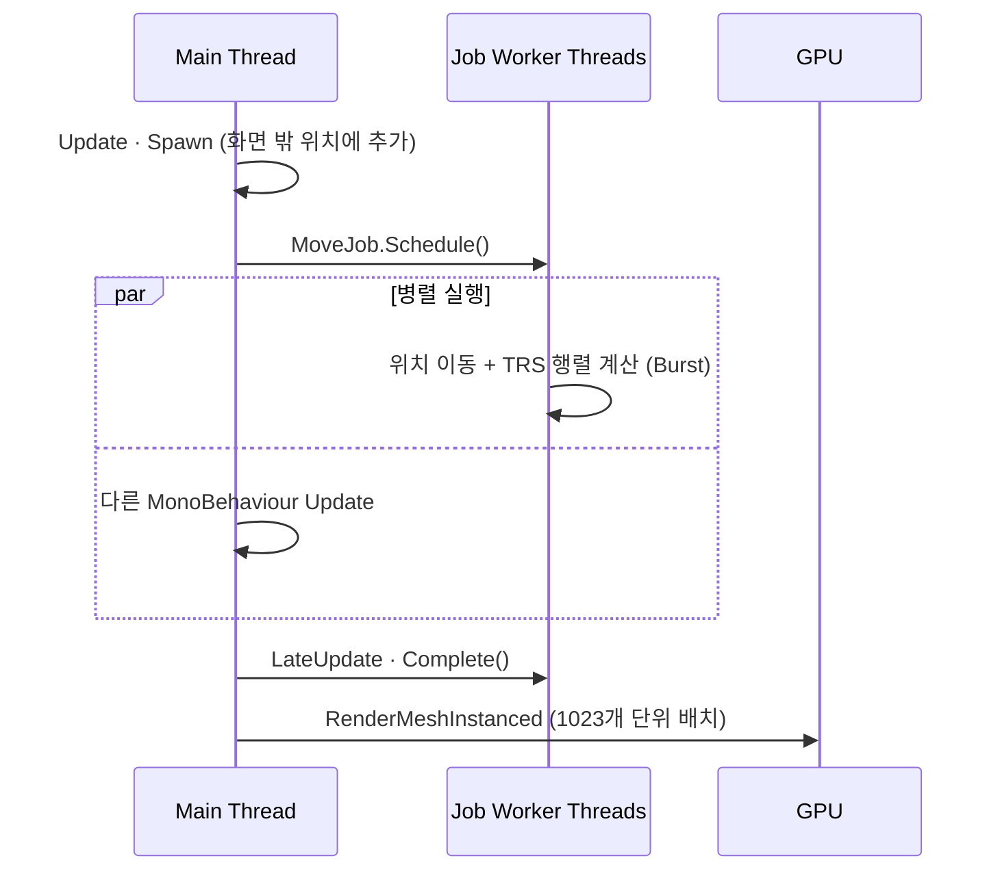
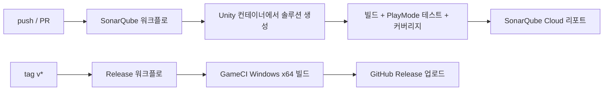

# portfolio-01

> **수천 마리의 적을 GameObject 없이** — Unity 6 · Job System · Burst · GPU Instancing 기반 쿼터뷰 서바이벌 프로토타입

[](Client/ProjectSettings/ProjectVersion.txt)
[](Client/Assets/Scripts/aisilol)
[](Client/Packages/manifest.json)
[](https://github.com/lolisia/portfolio-01/releases/latest)

[](https://sonarcloud.io/summary/new_code?id=lolisia_portfolio-01)
[](https://sonarcloud.io/summary/overall?id=lolisia_portfolio-01)
[](https://sonarcloud.io/summary/new_code?id=lolisia_portfolio-01)
[](https://sonarcloud.io/summary/new_code?id=lolisia_portfolio-01)
[](https://sonarcloud.io/summary/new_code?id=lolisia_portfolio-01)
[](https://github.com/lolisia/portfolio-01/actions/workflows/sonarqube.yml)
[](https://github.com/lolisia/portfolio-01/actions/workflows/release.yml)

<!--
  플레이 화면 GIF/스크린샷을 docs/images/ 에 넣고 아래 주석을 해제하세요.
  <p align="center"></p>
-->

---

## 한눈에 보기

| 항목 | 내용 |
| --- | --- |
| 장르 | 쿼터뷰 서바이벌 (플레이어를 향해 몰려드는 대량의 적) |
| 엔진 / 언어 | Unity 6 (6000.6.7f1), C# |
| 핵심 기술 | **C# Job System + Burst**, **GPU Instancing** (`Graphics.RenderMeshInstanced`), `NativeList` 데이터 지향 설계, Object Pooling, New Input System |
| 품질 관리 | PlayMode 테스트 50+개, 코드 커버리지 측정, SonarQube Cloud 정적 분석 (Quality Gate) |
| CI/CD | GitHub Actions + GameCI — 태그 push 시 Windows 빌드 & GitHub Release 자동 배포 |
| 다운로드 | [최신 Release (Windows x64)](https://github.com/lolisia/portfolio-01/releases/latest) |

## 주요 구현 포인트

### 1. GameObject 없는 대량 Enemy 처리 — [`EnemySpawner.cs`](Client/Assets/Scripts/aisilol/Game/EnemySpawner.cs)

적 하나당 GameObject를 만드는 대신, **위치·속도를 `NativeList`로만 관리**하고 렌더링은 GPU Instancing으로 일괄 처리합니다.

- **Burst 컴파일된 `IJobParallelFor`** 로 모든 적의 이동과 TRS 행렬 계산을 멀티스레드 병렬 처리
- `Update`에서 Job 예약 → `LateUpdate`에서 완료하여 **메인 스레드 작업과 Job이 겹쳐서 실행**
- `Graphics.RenderMeshInstanced`로 **Draw Call 1회당 최대 1023개** 인스턴스를 묶어 렌더링
- Enemy Prefab은 Mesh / Material / Scale / 속도 설정을 읽는 **템플릿으로만 사용** (Instancing 미설정 시 에러로 검출)
- 스폰 위치는 카메라 Viewport 네 모서리를 지면에 투영해 **항상 화면 밖**에서 생성, 줌 변경 시 재계산

### 2. 카메라 시야 기반 무한 바닥 — [`FloorManager.cs`](Client/Assets/Scripts/aisilol/Game/FloorManager.cs)

- 카메라 Frustum과 지면 평면의 교차 영역만 계산해 **보이는 타일만 배치**
- 화면 밖으로 나간 타일은 비활성화 후 **Pool에 반환하여 재사용** (Instantiate/Destroy 최소화)
- 지평선이 보이는 경우를 대비해 최대 시야 거리 제한

### 3. 방어적 초기화 & 디버깅 친화적 로그 — [`Utility.cs`](Client/Assets/Scripts/aisilol/Common/Utility.cs), [`Log.cs`](Client/Assets/Scripts/aisilol/Common/Log.cs)

- `TryInstantiate`, `TryGetComponent`, `IsValid` 등 실패 가능한 단계를 모두 검증하고 조기 반환
- `[CallerFilePath]` / `[CallerLineNumber]` / `[CallerMemberName]` + `[HideInCallstack]`으로 **호출한 위치가 그대로 찍히는 로그**
- `SetInspectorName` 커스텀 Attribute + Editor 확장으로 Inspector 라벨 한글화

## 아키텍처



### 프레임 흐름 (Enemy)



## 테스트 & 품질

- **PlayMode 테스트** — [`Client/Assets/Tests`](Client/Assets/Tests): 모든 게임 컴포넌트(GameManager, EnemySpawner, FloorManager, GameCamera, PlayerController)와 공용 유틸에 대해 정상 경로뿐 아니라 **잘못된 Prefab/null 입력 시의 실패 경로**까지 검증
- **코드 커버리지** — `com.unity.testtools.codecoverage`로 OpenCover 리포트 생성 → SonarQube Cloud 연동
- **정적 분석** — main push / PR마다 [SonarQube Cloud](https://sonarcloud.io/summary/overall?id=lolisia_portfolio-01) 분석 (Quality Gate 통과 유지)

## CI/CD



- 워크플로: [`sonarqube.yml`](.github/workflows/sonarqube.yml), [`release.yml`](.github/workflows/release.yml)
- 서드파티 Action은 **커밋 SHA로 고정**하여 공급망 위험 최소화

## 실행 방법

### 빌드 파일로 실행
[Releases](https://github.com/lolisia/portfolio-01/releases/latest)에서 `portfolio-01-*-StandaloneWindows64.zip`을 받아 압축 해제 후 실행합니다.

### 에디터에서 실행
1. Unity Hub에서 **Unity 6000.6.7f1** 설치
2. `Client` 폴더를 프로젝트로 열기
3. `Assets/Scenes/GameScene.unity` 열고 Play

### 조작

| 입력 | 키보드 / 마우스 | 게임패드 |
| --- | --- | --- |
| 이동 | `W` `A` `S` `D` / 방향키 | 왼쪽 스틱 |
| 줌 | 마우스 휠 | — |
| 재시작 | 화면의 Restart 버튼 | — |

## 프로젝트 구조

```
Client/Assets
├── Scenes/GameScene.unity
├── Scripts/aisilol
│   ├── Common/      # Log, Utility (검증 + 호출 위치 로그)
│   ├── Editor/      # SetInspectorName 커스텀 에디터
│   ├── Game/        # GameManager, EnemySpawner, FloorManager, GameCamera, PlayerController
│   └── Input/       # Input System 생성 코드
└── Tests/           # PlayMode 테스트 (Common, Game)
```
