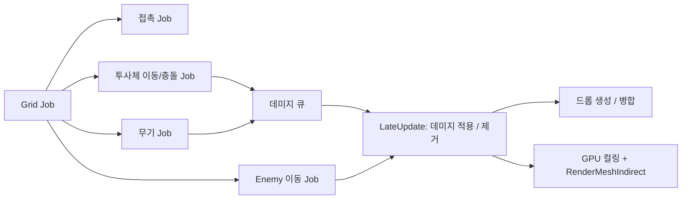

# portfolio-01

대량의 Enemy를 Burst Job과 GPU Instancing으로 처리하는 Unity 프로토타입.

<!--  -->

- Unity 6000.6.7f1, URP, Input System
- 다운로드: [Releases](https://github.com/lolisia/portfolio-01/releases/latest) (Windows x64)

## 구현

**Enemy** ([EnemyManager.cs](Client/Assets/Scripts/aisilol/Game/EnemyManager.cs))
- Enemy는 GameObject 없이 `NativeList`에 위치/속도/체력만 저장
- 매 프레임 Burst Job으로 공간 해시 격자([SpatialGrid.cs](Client/Assets/Scripts/aisilol/Game/SpatialGrid.cs))를 만들고, 이동 / 겹침 밀어내기 / 플레이어 접촉 판정이 격자를 공유
- 이동은 위치 이중 버퍼. 이웃 위치를 읽는 동안 덮어쓰지 않음
- Update에서 Job 예약, LateUpdate에서 완료 후 데미지 적용 / 사망 제거(swap-back)를 Burst `IJob`으로 처리
- 렌더링은 아래 렌더링 항목 참고
- 스폰 위치는 카메라 화면 모서리를 지면에 투영해서 화면 밖으로 계산
- Enemy 수는 고정 상한 없음. 평균 FPS(지수 이동 평균)가 기준 아래면 생성 중지
- 한 프레임 생성 수에 상한. 넘는 수는 이월하지 않음
- 피격 표시는 같은 Mesh에 피격 색 Material을 쓰는 렌더링 그룹으로 분리

**렌더링** ([InstanceRenderer.cs](Client/Assets/Scripts/aisilol/Game/InstanceRenderer.cs), [GpuInstanceRenderer.cs](Client/Assets/Scripts/aisilol/Game/GpuInstanceRenderer.cs))
- Enemy / 투사체 / 드롭 / 칼날 공용. GameManager 옵션으로 두 경로 전환
- GPU 경로: 행렬을 `GraphicsBuffer`로 올리고 Compute Shader([InstanceCulling.compute](Client/Assets/Resources/Shaders/InstanceCulling.compute))가 시야 판정 + 그룹별 수집 후 `Graphics.RenderMeshIndirect`로 그룹당 1회 렌더링. 보이는 수는 `AsyncGPUReadback`으로 받음
- GPU 경로 Shader([InstancedIndirect.shader](Client/Assets/Resources/Shaders/InstancedIndirect.shader))에서 정점 애니메이션. 인스턴스별 위상은 위치에서 계산
- CPU 경로: Burst Job으로 시야 판정 / 그룹 정렬 후 `Graphics.RenderMeshInstanced`로 1023개씩 렌더링 ([InstancedMesh.cs](Client/Assets/Scripts/aisilol/Game/InstancedMesh.cs))
- 그래픽 장치가 없거나(-nographics) Compute Shader를 지원하지 않으면 CPU 경로 사용

**투사체** ([ProjectileSystem.cs](Client/Assets/Scripts/aisilol/Game/ProjectileSystem.cs))
- 투사체도 GameObject 없이 데이터로 처리
- 목표 탐색은 격자에서 플레이어 셀부터 한 겹씩 넓혀 가며 찾고, 남은 겹이 찾은 거리보다 멀면 중단. 검사할 셀이 Enemy 수보다 많으면 전체 순회
- 이동 + 충돌은 Burst `IJobParallelFor`. 한 프레임 이동 구간(선분)으로 판정해서 빠른 투사체도 Enemy를 건너뛰지 않음
- 구간 위의 Enemy를 거리순으로 정렬해 판정
- 맞힌 Enemy는 `NativeQueue` 데미지 큐에 기록하고, EnemyManager가 LateUpdate에서 일괄 적용. 데미지를 기록하는 Job끼리는 순서대로 연결

**무기** ([WeaponSystem.cs](Client/Assets/Scripts/aisilol/Game/WeaponSystem.cs))
- 오라 / 칼날 / 연쇄 번개 모두 Enemy 격자를 검색하는 Burst Job. 피해는 데미지 큐에 기록
- 칼날은 칼날마다 `IJobParallelFor`, 연쇄 번개는 이미 맞힌 Enemy를 제외한 최근접 검색 반복

**드롭** ([PickupSystem.cs](Client/Assets/Scripts/aisilol/Game/PickupSystem.cs))
- 드롭도 GameObject 없이 데이터로 처리. 이동 / 획득 판정은 Burst Job
- Object 수를 줄이기 위해 가까운 Object를 병합. 셀 + 단계 키로 정렬 후 묶음 처리
- 드롭 생성 / 획득 / 제거는 Burst `IJob`

**데이터** ([PlayerStats.cs](Client/Assets/Scripts/aisilol/Game/PlayerStats.cs), [UpgradeDefinition.cs](Client/Assets/Scripts/aisilol/Game/UpgradeDefinition.cs))
- 강화 정의는 ScriptableObject 에셋([Data/Upgrades](Client/Assets/Data/Upgrades))

**게임 진행** ([GameManager.cs](Client/Assets/Scripts/aisilol/Game/GameManager.cs), [GameHud.cs](Client/Assets/Scripts/aisilol/Game/GameHud.cs))
- 상태 머신으로 진행 관리
- HUD는 uGUI를 코드로 구성

**Floor** ([FloorManager.cs](Client/Assets/Scripts/aisilol/Game/FloorManager.cs))
- 카메라 Frustum에 걸리는 타일만 배치, 벗어난 타일은 Pool로 재사용

**공용** ([Utility.cs](Client/Assets/Scripts/aisilol/Common/Utility.cs), [Log.cs](Client/Assets/Scripts/aisilol/Common/Log.cs))
- `TryInstantiate` / `TryGetComponent` 실패 시 Caller 정보(파일:라인)를 포함해 로그 출력

## 테스트 / CI

- PlayMode 테스트 193개: [Client/Assets/Tests](Client/Assets/Tests). Job은 단위 테스트, 시스템은 빈 씬에서 통합 테스트
- push / PR 시 테스트 + 커버리지 + SonarQube Cloud 분석 ([sonarqube.yml](.github/workflows/sonarqube.yml))
- CI는 -nographics라 GPU 렌더링 테스트는 건너뛰고 GpuInstanceRenderer.cs는 커버리지에서 제외. 로컬 GPU 환경에서 실행
- `v*` 태그 push 시 GameCI로 Windows 빌드 후 Release 업로드 ([release.yml](.github/workflows/release.yml))

## 실행

`Client` 폴더를 Unity 6000.6.7f1로 열고 `Assets/Scenes/GameScene.unity` 실행.

| 입력 | 키 |
| --- | --- |
| 이동 | WASD / 방향키 / 왼쪽 스틱 |
| 줌 | 마우스 휠 |
| 강화 선택 | 1 / 2 / 3, 마우스 클릭 |
