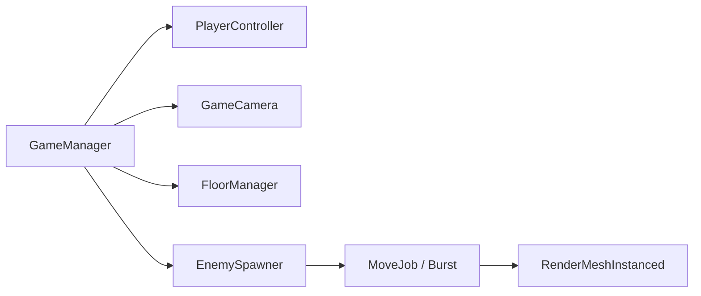

# portfolio-01

플레이어에게 몰려드는 대량의 적을 처리하는 Unity 쿼터뷰 프로토타입.

<!--  -->

- Unity 6000.6.7f1, URP, Input System
- 다운로드: [Releases](https://github.com/lolisia/portfolio-01/releases/latest) (Windows x64)

## 구현

**Enemy** ([EnemySpawner.cs](Client/Assets/Scripts/aisilol/Game/EnemySpawner.cs))
- Enemy는 GameObject 없이 `NativeList`에 위치/속도만 저장
- 이동은 Burst `IJobParallelFor`. Update에서 Schedule, LateUpdate에서 Complete
- 렌더링은 `Graphics.RenderMeshInstanced`로 1023개씩 묶어서 처리
- 스폰 위치는 카메라 화면 모서리를 지면에 투영해서 항상 화면 밖으로 계산

**Floor** ([FloorManager.cs](Client/Assets/Scripts/aisilol/Game/FloorManager.cs))
- 카메라 Frustum에 걸리는 타일만 배치, 벗어난 타일은 Pool로 재사용

**공용** ([Utility.cs](Client/Assets/Scripts/aisilol/Common/Utility.cs), [Log.cs](Client/Assets/Scripts/aisilol/Common/Log.cs))
- `TryInstantiate` / `TryGetComponent` 실패 시 Caller 정보(파일:라인)를 포함해 로그 출력

## 테스트 / CI

- PlayMode 테스트: [Client/Assets/Tests](Client/Assets/Tests)
- push / PR 시 테스트 + 커버리지 + SonarQube Cloud 분석 ([sonarqube.yml](.github/workflows/sonarqube.yml))
- `v*` 태그 push 시 GameCI로 Windows 빌드 후 Release 업로드 ([release.yml](.github/workflows/release.yml))

## 실행

`Client` 폴더를 Unity 6000.6.7f1로 열고 `Assets/Scenes/GameScene.unity` 실행.

| 입력 | 키 |
| --- | --- |
| 이동 | WASD / 방향키 / 왼쪽 스틱 |
| 줌 | 마우스 휠 |
